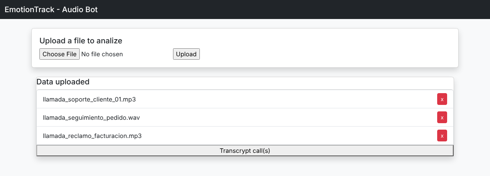
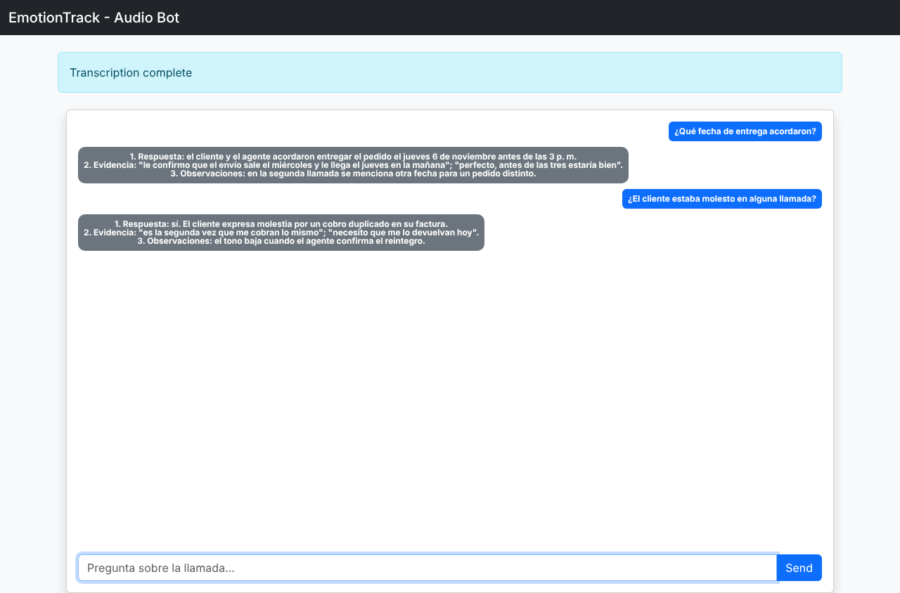
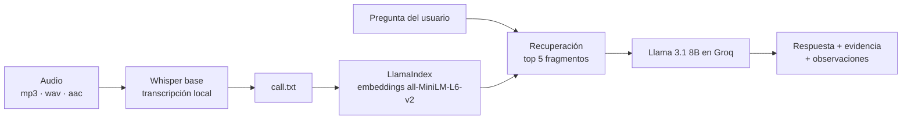

# EmotionTrack

Asistente para analizar llamadas telefónicas grabadas. Transcribe los audios con un modelo de reconocimiento de voz y permite hacerle preguntas en lenguaje natural sobre lo que se dijo. Las respuestas se basan únicamente en la transcripción e incluyen la evidencia que las respalda.


---

## Capturas


*Carga de grabaciones*

| Preguntas sobre las llamadas: respuesta, evidencia y observaciones |
|---|
|  |

> Capturas de las vistas reales del proyecto, generadas con datos de ejemplo.

## Qué hace

1. **Carga de audios:** el usuario sube grabaciones en MP3, WAV o AAC. Se valida la extensión y el tipo MIME de cada archivo.
2. **Transcripción:** cada audio se convierte a texto con Whisper, ejecutado localmente.
3. **Preguntas sobre la llamada:** el usuario pregunta, por ejemplo, "¿qué acordaron sobre la fecha de entrega?". El sistema busca los fragmentos más relevantes de la transcripción y se los entrega al modelo de lenguaje para responder.

## Cómo funciona



El sistema usa **RAG (generación aumentada por recuperación)**: en lugar de enviar la transcripción completa al modelo, indexa el texto con embeddings y recupera solo los 5 fragmentos más relacionados con la pregunta.

### Diseño del prompt

El modelo actúa como un analista riguroso de llamadas. Las instrucciones le exigen:

- responder solo con información presente en la transcripción, sin inventar;
- considerar que el contexto puede mezclar varias llamadas;
- devolver la respuesta en tres partes: respuesta directa, evidencia del texto y observaciones (ambigüedades o inconsistencias);
- indicar explícitamente cuando la transcripción no contiene información suficiente.

## Tecnologías

| Capa | Herramientas |
| --- | --- |
| Backend | Python 3.12, Flask |
| Voz a texto | OpenAI Whisper (modelo `base`, local) |
| Recuperación | LlamaIndex, embeddings de Hugging Face (`sentence-transformers/all-MiniLM-L6-v2`) |
| LLM | Llama 3.1 8B Instant en Groq, mediante la API compatible con OpenAI |
| Frontend | HTML, Bootstrap, JavaScript (fetch) |

## Estructura

```
app/
├── __init__.py      # Application factory de Flask
├── routes.py        # Carga, eliminación y transcripción de audios; endpoint de preguntas
├── LoadAudio.py     # Transcripción con Whisper
├── Ai_agent.py      # Indexación, recuperación y consulta al LLM
└── templates/
    └── index.html   # Interfaz de carga y chat
run.py
requirements.txt
```

## Cómo correrlo

**Requisitos:** Python 3.12, [FFmpeg](https://ffmpeg.org/) instalado (lo necesita Whisper) y una API key gratuita de [Groq](https://console.groq.com/).

```bash
git clone https://github.com/ozco26/EmotionTrack.git
cd EmotionTrack
python -m venv venv
source venv/bin/activate        # En Windows: venv\Scripts\activate
pip install -r requirements.txt

# Configura tu API key
echo "GROQ_API_KEY=tu_api_key" > .env

python run.py
```

La app queda en `http://127.0.0.1:8090`. La primera ejecución descarga los modelos de Whisper y de embeddings, así que puede tardar unos minutos.

## Endpoints

| Método | Ruta | Descripción |
| --- | --- | --- |
| GET | `/` | Interfaz principal con la lista de audios cargados |
| POST | `/charge_audio` | Sube un archivo de audio |
| GET | `/delete_audio/<archivo>` | Elimina un audio |
| POST | `/transcript` | Transcribe todos los audios cargados |
| GET | `/ask?q=<pregunta>` | Responde una pregunta sobre las transcripciones |

## Próximos pasos

- Análisis de emociones y tono por hablante, el objetivo que da nombre al proyecto.
- Persistir el índice vectorial para no reconstruirlo en cada pregunta.
- Separar las transcripciones por llamada y por hablante.

---

Desarrollado por **José Pablo Orozco Salas** · [LinkedIn](https://www.linkedin.com/in/jos%C3%A9-pablo-orozco-salas-8b766bb8/) · [GitHub](https://github.com/ozco26)
